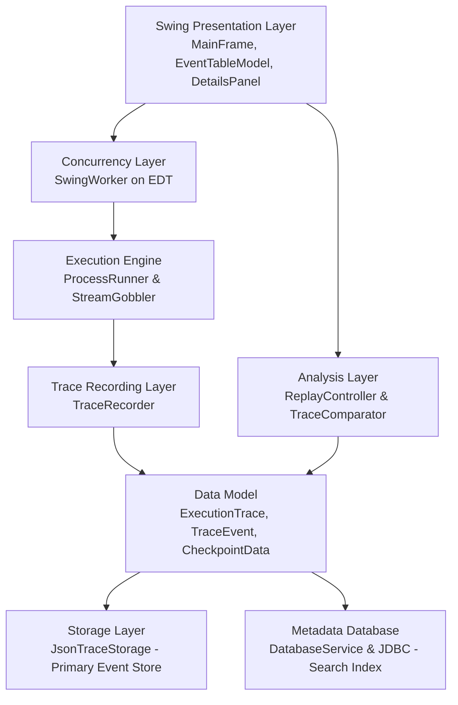

# BugReplay — Java Execution Recording & Bug Investigation Tool

**BugReplay** is a lightweight educational desktop application built with Java Swing that compiles, executes, records, and investigates the execution of compatible Java programs. It captures process-level runtime evidence (stdout, stderr, exit codes, execution timing), preserves recorded histories in structured JSON format, mirrors searchable metadata into MySQL via JDBC, and enables side-by-side trace comparison to assist students in understanding and isolating software bugs.

---

## 1. Academic Positioning & Honest Claims

- **Educational Prototype**: BugReplay is an undergraduate CSE laboratory tool designed to demonstrate core Java competencies—OOP, multithreading, concurrency deadlock prevention, `ProcessBuilder`, exception management, Swing GUI development, JSON serialization, and relational database persistence with JDBC.
- **Evidence-Based Observation vs. Root-Cause Diagnosis**: BugReplay observes and reports empirical execution discrepancies (e.g., exit code changes, divergent stdout lines, and variable values at explicit checkpoints). It **does not** claim to automatically diagnose the root cause of bugs or replace professional bytecode debuggers (such as JDB or IntelliJ Debugger).
- **Process-Level Recording vs. Bytecode Instrumentation**: Version 1 captures process-level events and explicit user-declared checkpoints via stdout markers (`BUGREPLAY_CHECKPOINT:`). It **does not** perform arbitrary Java bytecode rewriting or deterministic JVM replay.

---

## 2. Software Architecture

BugReplay follows a decoupled, layered Model-View-Controller (MVC) architecture with hybrid storage:



### Layer Responsibilities

1. **Presentation (`com.bugreplay.ui`)**:
   - `MainFrame`: The primary application window with file selection, run/cancel controls, status indicators, and tabs.
   - `EventTableModel`: Custom `AbstractTableModel` backing the chronological event `JTable`.
   - `EventDetailsPanel`: Renders detailed payload and parses checkpoint variables into an inspection table.
   - `HistoryDialog`: Browses past runs from MySQL (when connected) or falls back to local JSON trace directory scanning.
   - `CompareDialog`: Side-by-side trace diffing dialog presenting an evidence-based comparison report.
2. **Execution Runner (`com.bugreplay.runner`)**:
   - `ProcessRunner`: Compiles `.java` files using `javac` and runs child JVMs using `java` via `ProcessBuilder`. Enforces execution timeouts and forced process termination.
   - `StreamGobbler`: Dedicated background `Runnable` threads concurrently draining stdout and stderr to eliminate operating system pipe deadlocks.
   - `ExecutionResult`: Immutable container holding raw process exit code, stdout/stderr lines, start/end timestamps, and duration.
3. **Data Model (`com.bugreplay.model`)**:
   - `TraceEventType`: Enum declaring `RUN_STARTED`, `OUTPUT`, `ERROR_OUTPUT`, `CHECKPOINT`, `RUN_FINISHED`, `RUN_FAILED`, `RUN_TIMED_OUT`.
   - `TraceEvent`: Discrete event with a strictly monotonic sequence number (`1, 2, 3...`), timestamp, type, message, and checkpoint payload.
   - `CheckpointData`: Named internal state snapshot holding key-value variable pairs.
   - `ExecutionTrace`: Complete execution recording containing metadata, duration, exit code, format version, and events.
   - `RunMetadata`: Relational metadata representation for MySQL indexing.
4. **Recording (`com.bugreplay.recorder`)**:
   - `TraceRecorder`: Generates unique run IDs, produces monotonic sequence numbers, intercepts `BUGREPLAY_CHECKPOINT` markers from stdout, and constructs `ExecutionTrace`.
5. **Replay & Analysis (`com.bugreplay.analysis`)**:
   - `ReplayController`: Manages stepping through recorded traces (First, Previous, Next, Last, Jump).
   - `TraceComparator`: Evaluates observed differences across status, exit codes, durations, stdout lines, and checkpoint variable states.
   - `ComparisonResult`: Container generating structured investigation reports with academic disclaimers.
6. **Storage (`com.bugreplay.storage`)**:
   - `JsonTraceStorage`: Primary source of truth. Serializes and validates traces to indented JSON using Google Gson with overwrite protection and sequence validation.
   - `DatabaseService`: Manages JDBC connectivity, PreparedStatements, and graceful degradation when MySQL is offline.
   - `ConfigManager`: Reads database settings safely from `config.properties` or environment variables without hardcoded credentials.

---

## 3. Project Directory Structure

```
BugReplay/
├── pom.xml                         # Maven build configuration
├── README.md                       # Comprehensive project documentation
├── .gitignore                      # Prevents committing local credentials
├── config.example.properties       # Sample MySQL configuration template
├── run.bat                         # Desktop GUI launcher script
├── run-all-tests.bat               # Master test runner (runs all 25 automated tests)
├── run-phase2.bat                  # Phase 2 test suite runner
├── run-phase3.bat                  # Phase 3 test suite runner
├── run-phase4.bat                  # Phase 4 test suite runner
├── run-phase5.bat                  # Phase 5 test suite runner
├── database/
│   └── schema.sql                  # MySQL database and table definition
├── lib/                            # Local runtime JARs
│   ├── gson-2.10.1.jar             # Google Gson JSON library
│   └── mysql-connector-j-8.3.0.jar # MySQL JDBC Connector
├── traces/                         # Storage directory for recorded JSON traces
├── examples/                       # Demonstration programs
│   ├── NormalExample.java          # Predictable clean loop calculation
│   ├── CheckpointExample.java      # Emits 3 structured internal checkpoints
│   ├── BuggyDiscount.java          # Demonstrates integer division bug
│   ├── FixedDiscount.java          # Demonstrates corrected percentage calculation
│   ├── ExceptionExample.java       # Unhandled ArithmeticException (/ by zero)
│   ├── TimeoutExample.java         # Infinite loop for timeout/kill testing
│   └── CompilationErrorExample.java# Syntax error for compiler error capture
└── src/
    ├── main/java/com/bugreplay/    # Production application source code
    └── test/java/com/bugreplay/    # Comprehensive test suites
```

---

## 4. Prerequisites & Setup

### Environment Requirements
- **Java Development Kit (JDK)**: Java 8 or higher (tested with Oracle JDK `1.8.0_202`).
- **Operating System**: Windows (tested on Windows 10/11) or cross-platform Linux/macOS.
- **MySQL Server (Optional)**: MySQL 8.x or 9.x (service `MySQL97` or `MySQL80`). If MySQL is offline, BugReplay runs in resilient JSON-only mode.

### Database Setup (Optional)
To enable MySQL metadata recording:
1. Open Command Prompt and execute the schema script:
   ```cmd
   "C:\Program Files\MySQL\MySQL Server 9.7\bin\mysql.exe" -u root -p < database\schema.sql
   ```
2. Copy the example configuration:
   ```cmd
   copy config.example.properties config.properties
   ```
3. Open `config.properties` in a text editor and enter your local MySQL password:
   ```properties
   db.enabled=true
   db.url=jdbc:mysql://localhost:3306/bugreplay?useSSL=false&serverTimezone=UTC&allowPublicKeyRetrieval=true
   db.username=root
   db.password=your_mysql_password
   ```

*Note: If `config.properties` is omitted or MySQL is stopped, BugReplay functions completely and stores traces in `traces/`.*

---

## 5. How to Build and Run

### Launching the Desktop Application
Double-click `run.bat` or execute in PowerShell / Command Prompt:
```cmd
cd "C:\Users\arave\OneDrive\Desktop\java c & p"
.\run.bat
```

### Running the Complete Automated Test Suite
To verify all 25 automated tests across all 5 test suites:
```cmd
.\run-all-tests.bat
```

### Building with Apache Maven (if Maven is installed)
```cmd
mvn clean test
mvn clean package
```

---

## 6. Faculty Demonstration Workflow

Follow these steps to demonstrate BugReplay to evaluators:

### Step 1: Normal Execution & Process Recording
1. Launch the app using `.\run.bat`.
2. Select **`NormalExample.java`** from the Example dropdown.
3. Click **Run Program**.
4. **Point out to faculty**:
   - The UI remained responsive during execution.
   - The **Event Table** shows 9 ordered events starting with `RUN_STARTED` (#1) and ending with `RUN_FINISHED` (#9).
   - Click any event in the table to show the payload update in the **Selected Event Details** panel.
   - Show the **Saved JSON Trace** tab demonstrating formatted persistence.

### Step 2: Checkpoint Inspection
1. Select **`CheckpointExample.java`** from the dropdown and click **Run Program**.
2. In the event table, click on any event of type `CHECKPOINT` (e.g. `AFTER_DEPOSIT`).
3. **Point out to faculty**:
   - BugReplay parsed the checkpoint token from stdout.
   - An internal table appeared showing variable names (`account`, `balance`, `depositAmount`) and their recorded values at that exact point in time.

### Step 3: Runtime Exception & Compilation Failure Capture
1. Select **`ExceptionExample.java`** and click **Run Program**.
   - Show status update: `Status: Failed (Exit Code 1)`.
   - Show that standard error captured the `ArithmeticException: / by zero` stack trace.
2. Select **`CompilationErrorExample.java`** and click **Run Program**.
   - Show that `javac` compiler errors are captured cleanly without crashing the GUI.

### Step 4: Timeout & Forced Process Termination
1. Select **`TimeoutExample.java`** and set **Timeout (ms)** to `2000`.
2. Click **Run Program**.
3. **Point out to faculty**:
   - The child process ran in an infinite loop.
   - At exactly 2000 ms, BugReplay forcibly killed the child process using `destroyForcibly()`.
   - The event table recorded `RUN_TIMED_OUT`.

### Step 5: Bug Investigation & Trace Comparison
1. Execute **`BuggyDiscount.java`** (which has an integer division bug: `15 / 100 = 0`).
2. Execute **`FixedDiscount.java`** (which calculates `15 / 100.0 = 0.15`).
3. Click the **Compare Traces...** button in the top toolbar.
4. Select the Buggy trace as Trace A and the Fixed trace as Trace B. Click **Compare Recordings**.
5. **Point out to faculty**:
   - The **Checkpoint Differences** tab highlights where the state diverged: `discountApplied` was `0.0` in Trace A vs `15.0` in Trace B; `finalTotal` was `100.0` vs `85.0`.
   - The **Investigation Report** includes the academic disclaimer distinguishing observed differences from root-cause claims.

### Step 6: History & Database Fallback
1. Click **View History...** in the toolbar.
2. Show that previous runs are cataloged in a searchable table.
3. Show the banner: if MySQL is connected, it displays `Data Source: MySQL Database (Connected)`; if offline, it displays `Data Source: Local JSON Directory (MySQL Offline)` and still works seamlessly.
4. Select any past run and click **Load into Viewer** to reload its entire history.

---

## 7. Viva Preparation Guide & Core Concepts

Be prepared to answer these common oral examination questions:

### 1. Process Execution & Concurrency
- **Q: Why did you use `ProcessBuilder` instead of `Runtime.getRuntime().exec()`?**
  - *Answer*: `ProcessBuilder` provides greater flexibility, cleaner separation of command-line arguments without shell injection vulnerabilities on Windows, independent stream management, and environment variable controls.
- **Q: What is a "Process Stream Deadlock" and how does `StreamGobbler` resolve it?**
  - *Answer*: Operating systems allocate a limited buffer (around 4 KB on Windows) for a child process's stdout and stderr streams. If a process prints more data than the buffer can hold, and the parent process is waiting for the child to exit before reading the stream, both processes wait for each other indefinitely—a deadlock. `StreamGobbler` runs on two dedicated background threads that drain stdout and stderr concurrently as fast as bytes arrive.
- **Q: How does BugReplay enforce process timeouts?**
  - *Answer*: We call `process.waitFor(timeoutMillis, TimeUnit.MILLISECONDS)`. If the method returns `false`, the time limit has elapsed, and we call `process.destroyForcibly()` to immediately terminate the runaway child process.

### 2. Swing Concurrency & Thread Safety
- **Q: What is the Event Dispatch Thread (EDT) and why is `SwingWorker` required?**
  - *Answer*: Swing GUI components are not thread-safe and must only be modified on the EDT. If long-running tasks (compilation or execution) run on the EDT, the window freezes ("Not Responding"). `SwingWorker` executes the heavy compilation and execution on a background thread (`doInBackground()`) and posts updates back to the EDT via `done()`.

### 3. Data Integrity & Serialization
- **Q: Why did you assign strictly monotonic sequence numbers to events?**
  - *Answer*: System wall clocks have limited resolution (often 1–15 ms on Windows) and can produce identical timestamps for rapid sequential events. An integer sequence number (`1, 2, 3... N`) guarantees a deterministic total ordering.
- **Q: How does `JsonTraceStorage` validate trace files?**
  - *Answer*: When loading a JSON file with Gson, it validates that `runId`, `events`, and `formatVersion` are valid, and verifies that sequence numbers increment strictly by 1 without gaps or reversals.

### 4. Database & JDBC
- **Q: Why are `PreparedStatements` mandatory?**
  - *Answer*: Prepared statements pre-compile the SQL structure on the database server and treat parameter placeholders (`?`) strictly as data, neutralizing SQL Injection attacks.
- **Q: Explain BugReplay's Graceful Degradation design.**
  - *Answer*: Primary execution evidence is saved as JSON files. MySQL is used purely for indexing metadata. If the MySQL server is unreachable, `DatabaseService` logs a notice and allows the application to proceed in JSON-only mode without crashing.

---

## 8. Summary of Automated Tests

| Test Suite | Class Name | Tests | Status |
| :--- | :--- | :---: | :---: |
| **Phase 2** | `com.bugreplay.runner.Phase2TestRunner` | 5 | **PASSED** |
| **Phase 3** | `com.bugreplay.storage.Phase3TestRunner` | 7 | **PASSED** |
| **Phase 4** | `com.bugreplay.ui.Phase4UiTest` | 4 | **PASSED** |
| **Phase 5 (Offline)** | `com.bugreplay.storage.Phase5DatabaseTest` | 5 | **PASSED** |
| **Phase 5 (Live MySQL)** | `com.bugreplay.storage.DatabaseLiveIntegrationTest` | 7 | **PASSED** |
| **Phase 6** | `com.bugreplay.analysis.TraceComparatorTest` | 4 | **PASSED** |
| **Total** | | **32 / 32** | **100% PASSED** |
